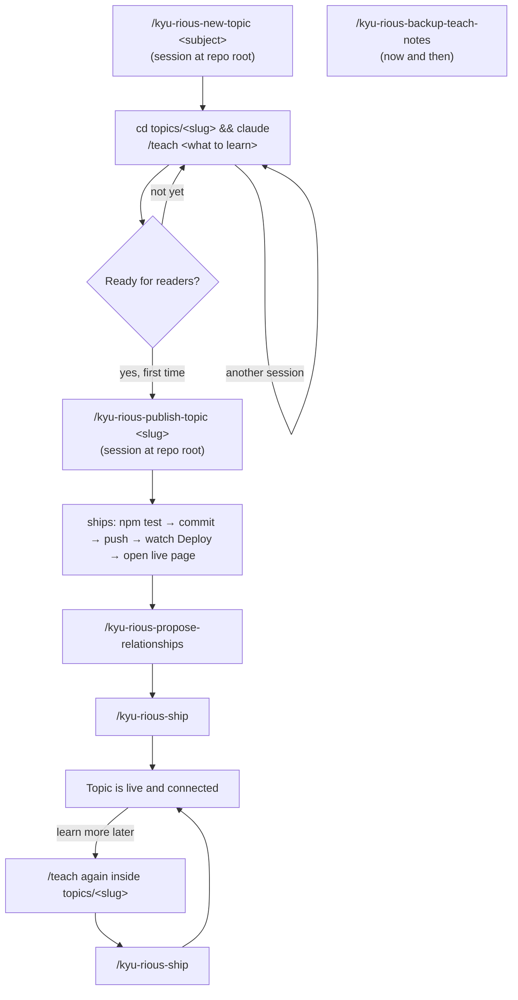
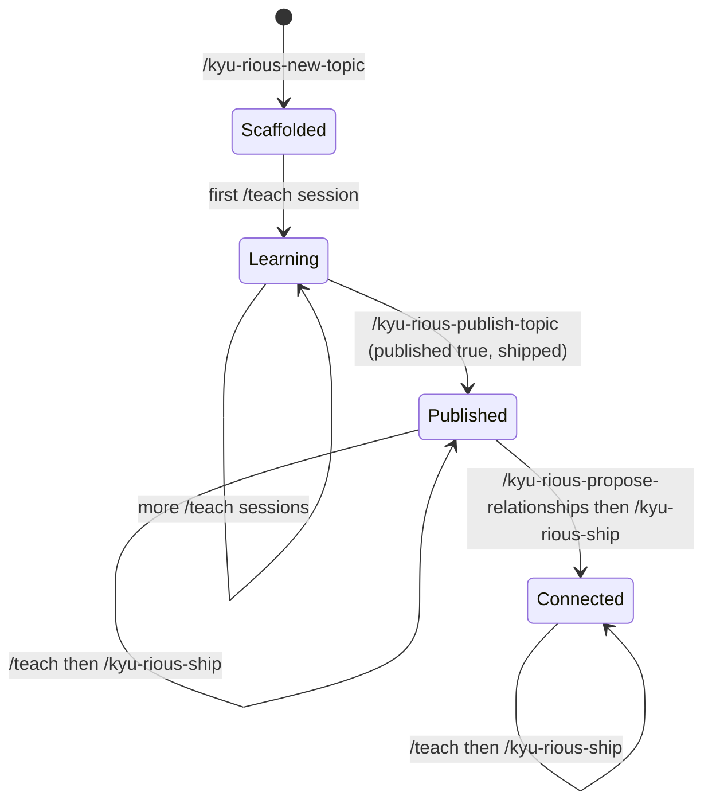
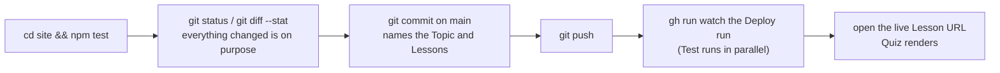

# Workflow: from "I want to learn X" to a Published Topic

The whole life of one Topic, end to end. Vocabulary follows `GLOSSARY.md`. Each step is run by typing a skill name in Claude Code; none fires on its own. `/kyu-rious` prints the short version of this table.

## The big picture



A Topic moves through four states:



## Two kinds of session

Where you start `claude` decides which tools are in reach.

| Start the session in        | Use it for                                                                                                   |
| --------------------------- | ------------------------------------------------------------------------------------------------------------ |
| the repo root               | every `/kyu-rious-*` skill: new topic, publish, ship, propose relationships, back up                          |
| `topics/<slug>/`            | `/teach` only. It treats the current directory as its workspace, and the repo's `CLAUDE.md` still applies     |

`/teach` writes files, so one session per Topic at a time.

## What lives where

```
kyu-rious/
├── topics/<slug>/                 one /teach workspace per Topic
│   ├── topic.yaml                 manifest: title, summary, published, exclude, relationships   PUBLIC
│   ├── ABOUT.md                   reader-facing "what this Topic covers" (optional)            PUBLIC
│   ├── lessons/
│   │   ├── 0001-<name>.html       one Lesson                                                   PUBLIC
│   │   └── 0001-<name>.quiz.js    its Quiz (window.QUIZ = [...])                               PUBLIC
│   ├── reference/<name>.html      Reference sheets                                             PUBLIC
│   ├── assets/                    shared stylesheet, quiz widget, simulators                   PUBLIC
│   ├── MISSION.md                 why you are learning this (about you)                        PRIVATE, gitignored
│   ├── NOTES.md                   the teacher's notes on how you like to learn                 PRIVATE, gitignored
│   ├── RESOURCES.md               trusted sources /teach found                                 PRIVATE, gitignored
│   ├── learning-records/          what you understood, what was corrected                      PRIVATE, gitignored
│   └── *.epub, *.pdf, index.html  never Published, epub/pdf never committed
├── site/                          the Astro generator; npm test is the gate before every push
├── docs/agents/shipping.md        the one procedure that puts a change on the live site
└── .claude/skills/kyu-rious-*/    the skills named below
```

"PUBLIC" means it is committed and, once the Topic has `published: true`, rendered at https://kyu-seok.github.io/kyu-rious/. "PRIVATE" files exist only on this laptop; the Test workflow fails the build if one is ever tracked. Because they are not in git, back them up (step 6).

## Step by step

### 0. One-time setup

```bash
cd site && npm ci
```

Needed so `npm test` (the build-seam tests) can run locally. Nothing else to configure; GitHub Pages is already set to deploy from Actions.

### 1. Create the Topic

From a session at the repo root:

```
/kyu-rious-new-topic the Node.js event loop
```

The skill proposes a slug (lower-case, hyphens, e.g. `node-event-loop`) and a title, asks you to confirm, then creates `topics/<slug>/` with empty `lessons/`, `reference/`, `assets/` and a `topic.yaml` with `published: false`. It runs `npm test` to prove the site is unchanged, then prints the hand-off command for step 2.

An unpublished Topic is invisible to the site, so you can commit it or leave it uncommitted; nothing changes either way.

### 2. Learn with /teach

```bash
cd ~/Work/kyu-rious/topics/<slug> && claude
```

then

```
/teach the Node.js event loop
```

What happens, roughly in order:

- **First session, before any lesson**: `/teach` asks why you want this and writes `MISSION.md`. It then looks for high-quality sources and records them in `RESOURCES.md`. Answer the "why" honestly; every Lesson is aimed at it.
- **Each session**: it reads `learning-records/` to find what you already know, picks the next thing inside your reach, and writes one short Lesson to `lessons/000N-<name>.html` with its Quiz in `lessons/000N-<name>.quiz.js`. It opens the Lesson in your browser from `file://`. Reference sheets land in `reference/` when a Lesson has something worth looking up later. After the session it writes a learning record.
- **Your part**: read the Lesson, take the Quiz, ask the teacher follow-up questions in the same session, say how you like to be taught (that goes to `NOTES.md`).

The Quiz convention from `CLAUDE.md` applies automatically because `CLAUDE.md` is loaded from the parent directory. The parts that matter to you as a reader of the site later:

- Every question has a permanent id `<slug>/<lesson-number>/q<n>`. Review Progress in readers' browsers is keyed by it, so ids are never renumbered or reused.
- Lessons and Reference sheets are written generically ("a small app you own"). Anything about you belongs in `MISSION.md` and `NOTES.md`.

Repeat step 2 as many sessions as you like. Nothing is public yet.

### 3. Publish the Topic (first time only)

When the Topic has enough Lessons to be worth reading, from a session at the repo root:

```
/kyu-rious-publish-topic <slug>
```

The skill walks through four decisions, one question at a time:

1. **Inventory**: a table of every Lesson (with or without a Quiz) and Reference sheet.
2. **Manifest**: you write the one-line `summary` (for the home page and Graph tooltips), choose any `exclude` (Lessons or Reference sheets to hold back) and `review.exclude` (Lessons or question ids to keep out of Review), and it sets `published: true`.
3. **ABOUT.md**: it drafts a reader-facing description from your private `MISSION.md`, with nothing about you in it. You approve, edit or decline it.
4. **Ship**: the procedure in the next section, to the end.

It finishes by suggesting step 5.

### 4. After every later /teach session: ship

Once a Topic is Published, each `/teach` session leaves new or changed Lessons on disk that are not yet live. From a session at the repo root:

```
/kyu-rious-ship
```

The skill lists what changed per Topic, checks every `.quiz.js` diff for a quiz id that moved or changed meaning (the one mistake that corrupts readers' Review Progress), then ships. If the changed Topic is not Published it says so and stops; use step 3 instead.

### 5. Connect it to the other Topics

```
/kyu-rious-propose-relationships
```

The skill builds the site, reads the Graph, and proposes typed Relationships between this Topic and the others: `requires`, `extends`, `contrasts-with`, `applies`. You accept or reject each one. Accepted ones are appended to `topic.yaml`, `npm test` verifies them, and the skill offers `/kyu-rious-ship` to put them on the live Graph. Until this step the new Topic sits in its own cluster.

Relationships are Topic to Topic only. Links inside a Lesson to another Lesson become `mentions` edges on their own.

### 6. Now and then: back up the private files

```
/kyu-rious-backup-teach-notes
```

Mirrors every Topic's `MISSION.md`, `NOTES.md`, `RESOURCES.md` and `learning-records/` to `~/Backups/kyu-rious-teach-notes` (or a directory you name). These are the teacher's memory of you; without them `/teach` starts a Topic from scratch. Run it before changing laptops.

## What "ship" means

Steps 3, 4 and 5 all end with the same procedure, kept in one place at `docs/agents/shipping.md`:



If you want to do it by hand:

```bash
cd site && npm test && cd ..
git status --short && git diff --stat
git add topics/<slug> && git commit -m "<Topic>: add Lesson N <name>"
git push
gh run list --workflow deploy.yml --limit 1      # take the run id
gh run watch <run-id> --exit-status
open "https://kyu-seok.github.io/kyu-rious/topics/<slug>/lessons/<stem>.html"
```

`npm test` is the gate. It fails on a dangling Relationship, an unknown type, a duplicate or malformed quiz id, a home path, or any string listed in the gitignored `topics/.private-strings`. Fix the file it names, never the test.

## Quick answers

- **Hold back one Lesson from a Published Topic**: add its stem to `exclude` in `topic.yaml`, then `/kyu-rious-ship`.
- **Keep one question out of Review but still show it in the Lesson**: add its id to `review.exclude`.
- **Unpublish a whole Topic**: set `published: false` and ship. The files stay in the repo but the site drops the Topic, its Lessons and its Review cards.
- **Rename a Lesson file**: the quiz ids use the Lesson number, not the stem, so renaming the stem is safe. Changing the number is not.
- **Delete a question**: remove it; never reuse its number. The next new question takes the next free number.
- **Preview locally before pushing**: `cd site && npm run dev`, or open the Lesson from `file://` as `/teach` does.
- **Which skill now?** Type `/kyu-rious`.
